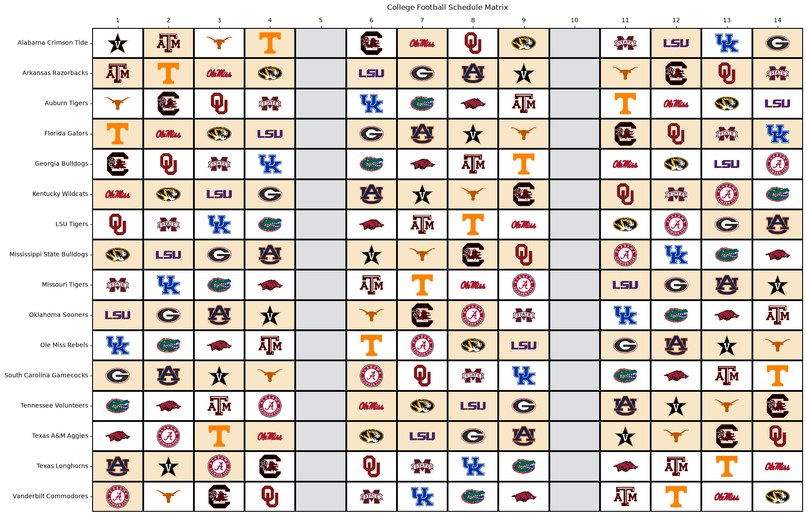

# cfb-viz

**A Python visualization library for college football.**

> **Current development version:** v0.1.0 (pre-release)  
> **Status:** Early development — schedule matrix visualization prototype implemented.

## Overview

`cfb-viz` aims to make it easier to create clean, customizable, publication-quality college football visualizations using Python and Matplotlib.

Instead of repeatedly writing custom plotting code, users can build schedule matrices from pandas DataFrames through reusable functions. The project initially focuses on NCAA Division I FBS football.

The current prototype displays team-by-week schedules with home, away, neutral-site, and BYE indicators, and supports opponent names, abbreviations, or team logos.

## Example Visualization

The following example demonstrates a schedule matrix generated using `cfb-viz`, featuring all 16 Southeastern Conference (SEC) teams.



**Disclaimer:** This visualization uses synthetically generated schedule data for demonstration and testing purposes only. The matchups, home/away designations, neutral-site assignments, and BYE weeks do not represent the official SEC schedule for any season.

Team names and logos are used for illustrative purposes only. This project is not affiliated with or endorsed by the NCAA, SEC, or any participating university.

## Development Status

### Current Progress

- [x] Initialize Python package using `uv`
- [x] Set up Git and GitHub repository
- [x] Define and validate the schedule DataFrame structure
- [x] Support Week 0 and schedule validation edge cases
- [x] Write automated tests using `pytest`
- [x] Implement team-by-week schedule matrix preparation
- [x] Implement schedule matrix visualization
- [x] Add custom figure sizes and cell colors
- [x] Add metadata for 138 FBS teams
- [x] Support full, short, and abbreviated opponent names
- [x] Add opponent-logo rendering to schedule cells
- [ ] Automatically scale logos to fit cells
- [ ] Add a home/away/neutral/BYE legend
- [ ] Finalize package assets and distribution
- [ ] Finalize and document the public API

## Schedule Data Format

The schedule validator expects a pandas DataFrame containing one row per game.

| Column | Type | Description |
|---|---|---|
| `week` | Integer | Nonnegative week number (Week 0 supported) |
| `home_team` | String | Officially designated home team |
| `away_team` | String | Officially designated away team |
| `neutral_site` | Boolean | Whether the game is played at a neutral site |

Additional columns are permitted.

**Team naming:** For reliable opponent-name and logo lookups, use the exact `ncaa_name` values in the bundled team metadata. Automatic alias resolution is not yet implemented.

## Quick Start

The project is currently in development. From a local checkout with dependencies installed, create a schedule and plot it:

```python
import pandas as pd
import matplotlib.pyplot as plt

from cfb_viz.plotting import plot_schedule

schedule = pd.DataFrame(
    [
        {
            "week": 1,
            "home_team": "Alabama Crimson Tide",
            "away_team": "Georgia Bulldogs",
            "neutral_site": False,
        },
        {
            "week": 2,
            "home_team": "Georgia Bulldogs",
            "away_team": "Alabama Crimson Tide",
            "neutral_site": True,
        },
    ]
)

fig, ax = plot_schedule(schedule, opponent_display="logo")
plt.show()
```

`plot_schedule()` returns a Matplotlib `(Figure, Axes)` tuple. Available `opponent_display` options are `"full"` (default), `"short"`, `"abbreviation"`, and `"logo"`.

You can also customize figure size and cell colors:

```python
fig, ax = plot_schedule(
    schedule,
    figsize=(10, 5),
    colors={"H": "#ffffff", "A": "#ffe4c4"},
    opponent_display="abbreviation",
)
```

The `colors` dictionary accepts location codes `H` (home), `A` (away), `N` (neutral), and `BYE`.

## Schedule Validation

The `validate_schedule()` function in `cfb_viz.validation` checks that:

- Input is a pandas DataFrame
- Required columns are present
- Week numbers are valid nonnegative integers
- Team names are nonempty strings
- Teams do not play themselves
- Neutral-site values are boolean
- Duplicate games are rejected
- Teams do not play multiple games in the same week

Invalid schedules raise a `TypeError` or `ValueError` with a descriptive message.

## Team Metadata and Logos

The project currently includes metadata for **138 FBS teams**, including team IDs, school names, mascots, short names, NCAA names, and ESPN abbreviations.

The `cfb_viz.teams` module provides `load_teams()`, `get_team()`, and `get_team_mapping()`. The `cfb_viz.logos` module provides `get_team_logo()`, which loads a team image as a Pillow image object.

Logo rendering is experimental. Logos currently use a fixed zoom level and may need adjustment for different figure sizes. Team names must match the metadata for successful logo lookup.

**Assets and trademarks:** Team names and logos may be protected by their respective owners. Review permissions and licensing before distributing logo files with a public package.

## Testing

Automated tests use `pytest` and cover validation, schedule preparation, plotting, and team metadata. Logo-loading tests are also being developed.

Run the full test suite:

```bash
uv run pytest -v
```

## Technology

- Python
- pandas
- NumPy
- Matplotlib
- Seaborn
- Pillow
- pytest
- uv

## Project Philosophy

- `cfb-viz` is primarily a **visualization library**, not a data collection or statistical analysis package.
- The initial release focuses on accepting user-provided data and producing reusable visualizations.
- Automatic data retrieval and advanced analytics are outside the scope of v0.1.0.

## Contributing

This project is under active development. Its public API and data requirements are not yet finalized.

Feedback and suggestions are welcome, but **pull requests are not being accepted at this time**.
